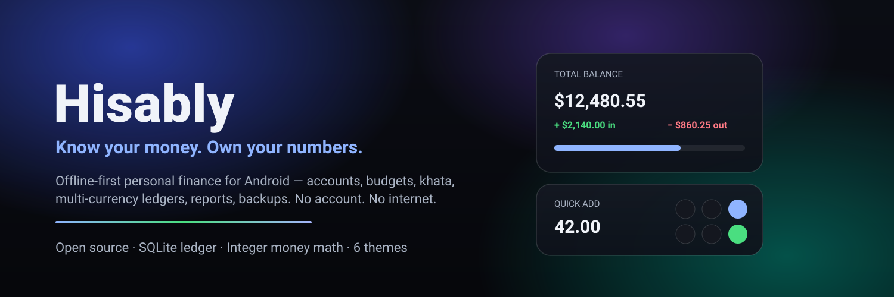
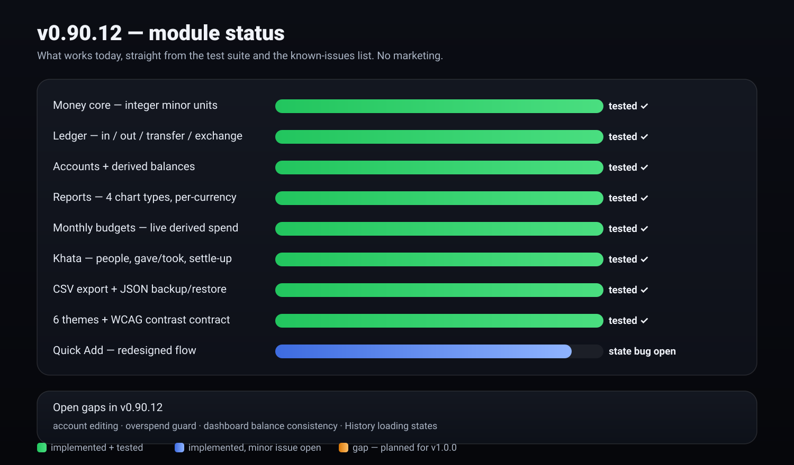
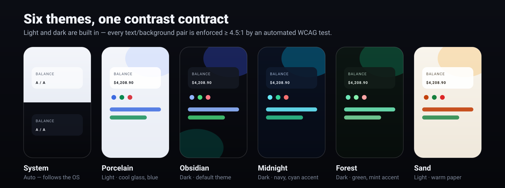
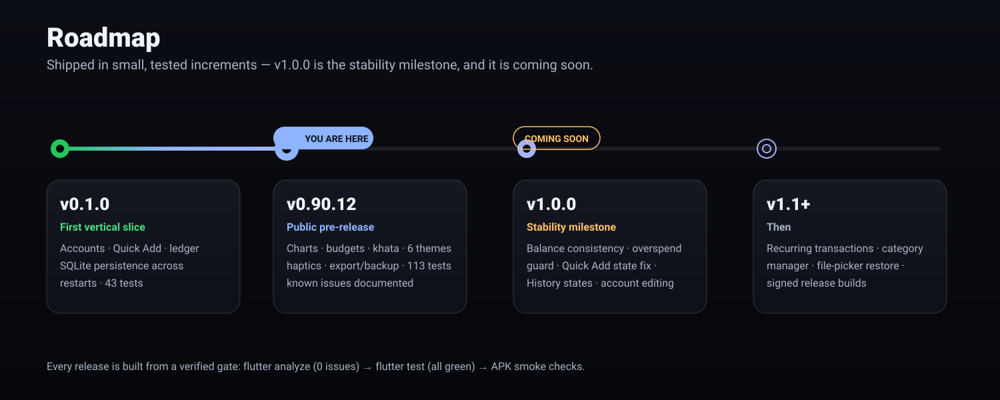

<div align="center">



# Hisably

**Know your money. Own your numbers.**

An offline-first, open-source personal finance app for Android.
No account. No internet. No analytics. Your data never leaves your device.

[](../../releases)
[](#-verification-gate)
[](#-verification-gate)
[](../../releases)
[](https://docs.flutter.dev)
[](https://dart.dev)
[](LICENSE)
[](#-privacy)

**Release type: Released** (development pre-release) · **v1.0.0 is coming soon** — see the [roadmap](#-roadmap--v100-is-coming-soon) and [known issues](#-known-issues--limitations-in-v09012) below.

</div>

---

Hisably is a personal ledger that treats **financial correctness as a feature, not an afterthought**. Every amount is stored as an integer number of minor units — binary floating point is never an authoritative representation of your money. Every balance is derived from the ledger, so it can always be re-computed from the raw rows. Everything runs locally on a single SQLite file via [Drift](https://drift.simonbinder.eu/): income and expense tracking, multi-account support (cash / bank / savings / digital wallet), transfers, manual currency exchange, monthly budgets, a personal *khata* (informal debt ledger), reports with four chart types, CSV export and full JSON backup/restore — wrapped in an original glassmorphism UI with six complete themes and optional haptics.

## ✨ What's inside

| | Feature | Details |
|---|---|---|
| ⚡ | **Quick Add** | Amount-first flow: custom keypad (system keyboard suppressed), In/Out toggle, inline currency symbol, haptic keys, one button that always names the next action |
| 🏦 | **Accounts** | Cash / bank / savings / wallet, per-account derived balances, account details with history |
| 🔁 | **Transfers & exchange** | Atomic single-row transfers that are never counted as income/expense; manual currency exchange stores both original amounts and derives the rate |
| 📊 | **Reports & charts** | 4 custom-painted chart types — category donut, daily in/out bars, monthly comparison bars, 30-day balance trend — always scoped to a single currency |
| 🎯 | **Budgets** | One monthly limit per (category, currency); live derived progress with ok / warning / over states |
| 🤝 | **Khata** | People ledger: gave / took entries, partial repayments as ordinary opposite entries, exact settle-up |
| 💾 | **Export & backup** | RFC-4180 CSV export; validated JSON backup & restore inside one transaction with foreign-key remapping |
| 🎨 | **6 themes** | System (auto), Porcelain & Sand (light), Obsidian & Midnight & Forest (dark) — every colour token explicit, WCAG contrast enforced by tests |
| 📳 | **Haptics** | Device-supported haptic feedback on keys, navigation, save and success — with a Profile toggle |
| 🔒 | **Private by design** | The release manifest requests **zero Android permissions**; no network code exists in the app |

## 📊 Module status — v0.90.12

Straight from the test suite and the issue list — no marketing:



### Project at a glance

| Metric | Value |
|---|---|
| Hand-written Dart (lib/) | 11,115 lines across 47 files |
| Generated persistence code (Drift) | 5,801 lines |
| Test suite | 113 tests · 9 suites · 1,435 lines |
| Themes | 6 (2 light · 3 dark · 1 auto) with automated WCAG contrast tests |
| Chart types in Reports | 4 |
| Screens | 12 (Home, Quick Add, Accounts, Account Details, History, Transfer, Exchange, Reports, Budgets, Khata, Khata Detail, Profile) |
| Runtime dependencies | 8 — all local-first (Riverpod, Drift, sqlite3, GoRouter, intl, shared_preferences) |
| Android permissions requested by release builds | **0** |

## 🎨 Themes

Two basic themes are light and dark — the rest are the fun part. Switch them any time from **Profile → Theme**.



## 🛣 Roadmap — v1.0.0 is coming soon



> ### ⏭️ Next up: **v1.0.0 (coming soon)**
> The update will be available soon and targets exactly the pain points listed below:
> correct dashboard/account balance calculations, an overspend guard by default, the Quick Add
> state reset fix, History loading/empty/error states, account editing, and a simplified dashboard.
> Watch the repo or check [Releases](../../releases) — **v1.0.0 is on its way.**

## ⚠️ Known Issues & Limitations in v0.90.12

<details open>
<summary><b>Release status: Development / Pre-release — not recommended for critical financial recordkeeping.</b></summary>

This version introduces the second iteration of Hisably, with improvements to the interface and
core financial management experience. However, several issues remain unresolved and may affect
usability, transaction reliability, and financial data accuracy.

### 1. Dashboard and account balance inconsistencies

- The total balance displayed on the dashboard may not match the balance shown on the Accounts page.
- Some account balances may display unexpectedly large negative values.
- Balance calculation and synchronization between different sections require further investigation.

### 2. Negative account balances

- The application currently allows transactions that exceed an account's available balance.
- This can result in negative account balances.
- Account-level spending limits and insufficient-balance validation are not yet enforced.

### 3. Quick Add — persistent success state

- After completing an In/Out transaction, reopening Quick Add may display the previous transaction's success screen.
- Users may need to restart the application to use Quick Add again.
- Transaction state and screen lifecycle management require fixing.

### 4. Transaction history — loading issue

- The History section may remain stuck on an infinite loading screen.
- Transaction records may not load correctly.
- Proper empty, error, and retry states are currently needed.

### 5. Account management limitations

- Existing accounts cannot currently be edited after creation.
- Users can create new accounts, but account modification functionality is missing.
- Account management requires additional flexibility.

### 6. Dashboard UI redundancy

- The dashboard contains a separate In/Out summary card that duplicates information available in Recent Activity.
- This creates unnecessary visual clutter and will be reconsidered in a future update.

</details>

### 🔐 Security & data integrity considerations

No confirmed security vulnerability has been established from the current review. However, the
following areas require verification before a stable release:

- Financial transaction validation
- Account balance integrity
- Protection against duplicate transactions
- Database consistency and recovery
- Secure local data storage and backup handling
- Input validation for monetary values and currency conversions

A dedicated security review has not yet been completed.

### 🧭 Planned improvements

- Correct dashboard and account balance calculations
- Prevent overspending beyond available account balances by default
- Fix Quick Add state persistence
- Resolve History loading issues
- Introduce account editing
- Simplify the dashboard layout
- Improve transaction validation and error handling
- Strengthen data integrity and application stability

### 💡 Recommendation

This is an early development release intended for testing and feedback. Users are encouraged to
report bugs and unexpected behavior through [GitHub Issues](../../issues).

> **Important:** Do not rely on this version as the sole record of important financial
> transactions. Maintain independent records and backups until the known issues are resolved
> and verified.

## 🧮 Money correctness

The part most finance apps get quietly wrong — here it is enforced by the type system and the test suite:

- **Integer minor units end to end.** Amounts are `int` values (e.g. cents); binary floating point is never an authoritative representation. Enforced by `test/core/money_test.dart`.
- **Explicit currency precision** per ISO 4217 (JPY = 0 decimals, USD = 2, BHD = 3…). Keypad input is capped to the currency's decimal digits.
- **Transfers are invisible to income/expense.** A transfer is one atomic ledger row; it never inflates either figure. Currency exchange keeps both original amounts verbatim and derives the effective rate with integer long division on read.
- **Every balance is reproducible.** `opening + Σ(income) − Σ(expense) − Σ(out-transfers/fees) + Σ(in-transfers)` — there is no mutable balance field anywhere in the schema. Budgets and khata balances are derived the same way.
- **Derived negatives are legal** (an overdrawn cash account after an exchange fee) and render via `Money.fromSigned`; user-entered amounts are non-negative by construction.
- **Charts never mix currencies.** Every series is scoped to one currency.

## 🙈 Privacy

- The **release manifest requests zero Android permissions** — no INTERNET, no storage, nothing. (The debug build adds INTERNET solely so the Flutter tool can hot-reload; standard tooling behaviour, absent from releases.)
- No analytics, no ads, no Firebase, no network code anywhere in the app.
- Exports and backups are written to the app's own documents directory; nothing is ever uploaded.
- Schema and repositories contain no user identity — there is nothing to leak.

## 🚀 Getting started

**Option A — install the APK (recommended for testing):**
grab `hisably-v0.90.12-debug.apk` from the [v0.90.12 release](../../releases) and sideload it
(arm64-v8a devices, Android 7.0+). It is a **debug build** — convenient for testing, not yet the
hardened release artifact.

**Option B — build from source:**

```bash
git clone https://github.com/huzaifaa-dev-vibe/hisably.git
cd hisably
flutter pub get
dart run build_runner build --delete-conflicting_outputs   # drift codegen
flutter analyze          # must report 0 issues
flutter test             # 113 tests must pass
flutter build apk --debug --target-platform android-arm64
```

Requirements: Flutter 3.47.8 (Dart 3.13.7), JDK 21, Android SDK 36 (minSdk 24).
On machines with < 8 GB RAM keep the tuned `android/gradle.properties` (the Flutter template
default `-Xmx8G` OOMs). Maven mirrors for rate-limited CI environments are pre-configured in
`android/settings.gradle.kts` with proper fallback order.

## 🏗 Architecture

Four layers, dependencies point inward only:

```
lib/
├── core/          # money, currency registry, DB schema, theme specs, haptics
├── data/          # repositories (validated + transactional writes), providers, settings
├── features/      # home, quick_add, accounts, transfer, exchange, reports,
│                  # budgets, khata, profile, shell
└── app.dart / app_router.dart / main.dart
```

Layer rules, ledger semantics, the Quick Add state machine, the migration strategy and the
trade-offs behind them are documented in [docs/ARCHITECTURE.md](docs/ARCHITECTURE.md).

The repository layer is deliberately shaped as a boundary: repositories own every mutation, so a
future sync engine can hook in without touching UI code.

## 🧪 Verification gate

Every release on this repo is expected to pass the same gate (recorded for v0.90.12):

| Check | Result |
|---|---|
| `flutter analyze` | 0 issues |
| `flutter test` | **113 / 113 passed** |
| WCAG contrast contract | enforced by test for all 6 themes (≥ 4.5:1 body text) |
| Release-manifest permissions | 0 (binary-verified via `aapt2 badging`) |
| Secret scan (source + APK) | clean |
| Network/analytics code | none found |

Honest limits: this project has **no emulator in its build environment** — no on-device run has
been performed; the published APK is a debug build for arm64-v8a; restore-from-backup currently
expects a manually provided file path (no SAF picker yet). These are first-priority items on the
road to v1.0.0.

## 📄 License

Released under the [MIT License](LICENSE) — free to use, study, modify and ship.

## 🔖 Tags

`personal-finance` · `expense-tracker` · `budget` · `khata` · `money-manager` · `offline-first` · `flutter` · `dart` · `android` · `sqlite` · `drift` · `riverpod` · `glassmorphism` · `multi-currency` · `open-source`

---

<div align="center">

**Hisably — Know your money. Own your numbers.**

Release type: Released · v0.90.12 (pre-release) · **v1.0.0 coming soon**

</div>
